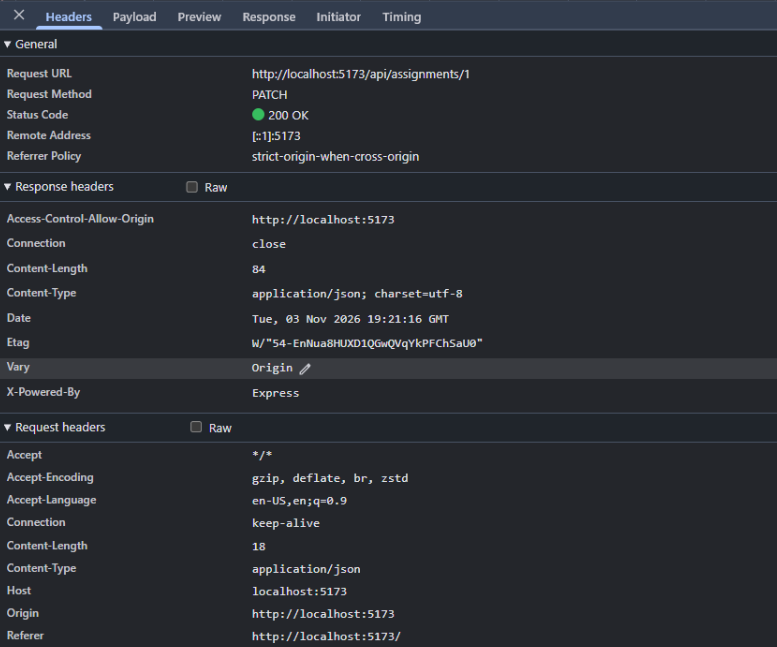
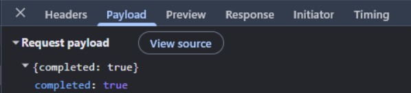
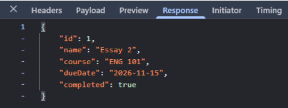
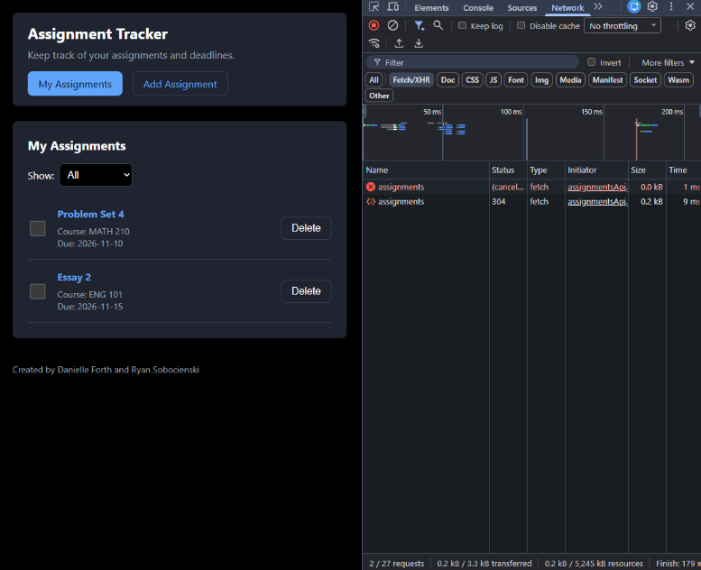
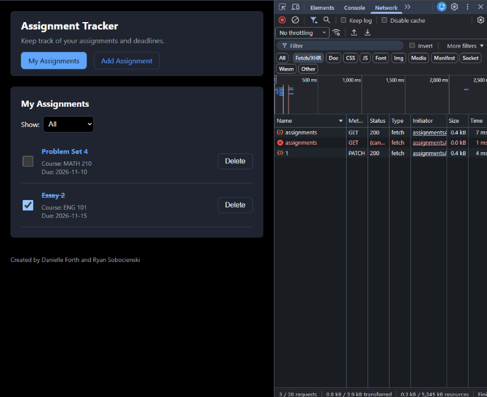

## Milestone 2 Analysis:
We were able to trigger a request-response cycle by clicking on the checkbox next to Essay 2 on the assignment tracker website. It was a PATCH http://localhost:5173/api/assignments/1 request. This URL uses the Vite dev server’s port, 5173, instead of Express’ because Vite’s proxy sends /api calls to the API, keeping the request of the same origin. The Content-Type of the request was application/json, which tells express.json() to parse the body. In response to the request, the server sent back a 200 OK status code, which our API contract specifies as a successful update. The response body showed the fully updated assignment:  {"id": 1, "name": "Essay 2", "course": "ENG 101", ”dueDate": "2026-11-15", "completed": true}. We checked off the box, so “completed” updating to true is exactly what we wanted. The response then updated the screen.
When the server replied with the 200 OK status code, the code automatically replaced the old version of Essay 2 with the new version sent by the server. Since the assignment was marked as completed, the “is-complete” style was applied, adding a strikethrough in the name of the assignment, Essay 2. If the request had failed, the checkbox and name of the assignment would not have changed and an error message would have appeared. 

## Debugging Analysis: Marking an Assignment as Completed

**Captured Request:** `PATCH /api/assignments/1`, which was triggered by checking off the checkbox next to the assignment titled, "Essay 2".

## Screenshots

**Figure One: Headers Tab** Request URL on port 5173, method: PATCH, status code: '200 OK', along with request and response headers.

**Figure Two: Payload Tab** The body that React sent, the only field that changed.

**Figure Three: Response Tab** The updated assignment that Express returned.

**Figure Four: UI Before the Click** Essay 2 is unchecked, and therefore incomplete.

**Figure Five: UI After the Click** Essay 2 is checked, and therefore complete.

